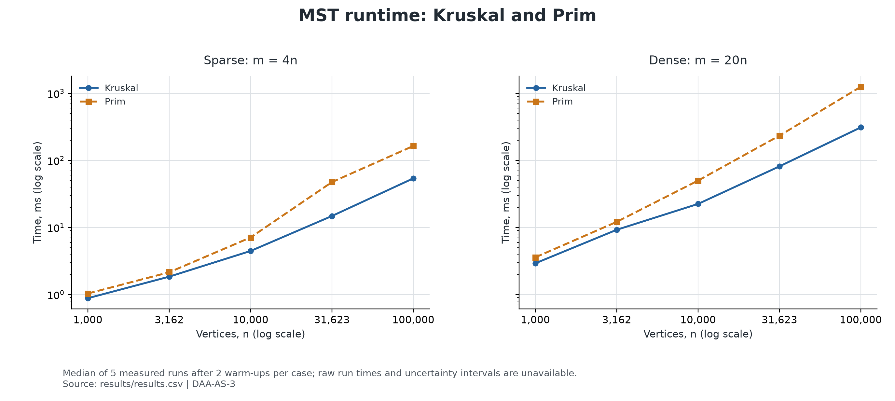
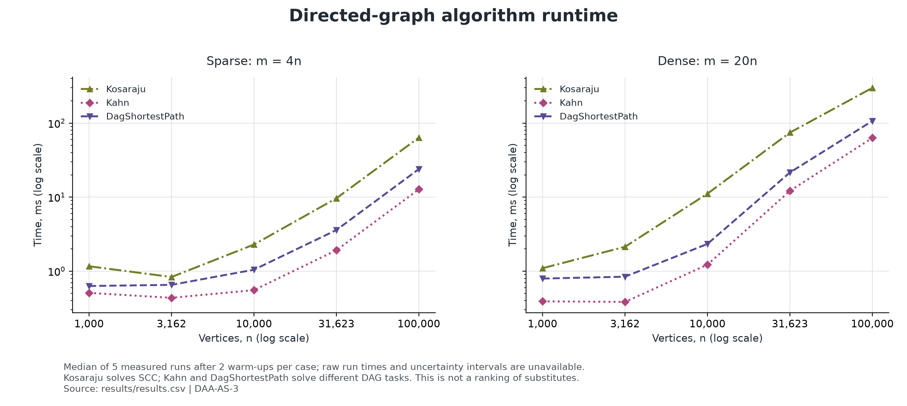
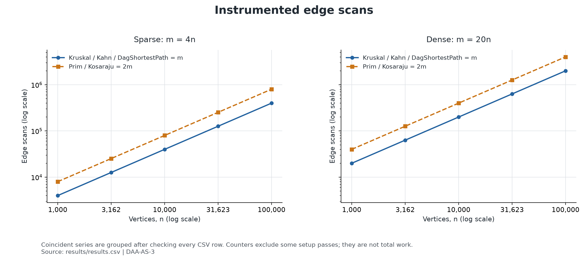
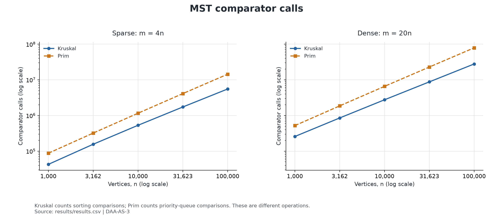
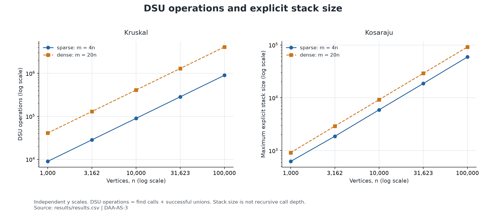

# DAA Assignment 3: Graph Algorithms and Experimental Analysis

**Author:** Sanzhar Karaulov

**Project:** DAA-AS-3

**Data:** [Benchmark results](results/results.csv)

## 1. Objective

This project implements and evaluates five graph algorithms: Kruskal and Prim for minimum spanning trees (MST), Kosaraju for strongly connected components (SCC), Kahn for topological sorting, and shortest paths in a directed acyclic graph (DAG). The experiment examines correctness, runtime growth, and instrumented operation counts as graph size and edge count increase.

Kruskal and Prim solve the same problem and are directly comparable on the same undirected graph. Kosaraju, Kahn, and DAG shortest paths solve different problems; their runtime curves describe their workloads rather than establish which algorithm is universally better.

## 2. Implementations and Theoretical Complexity

Let `n` be the number of vertices and `m` the number of logical edges. Graphs use adjacency lists and a separate edge list. An undirected edge appears twice in the adjacency lists but once in the edge list.

| Algorithm | Implementation | Time complexity | Additional space, excluding input graph |
| --- | --- | --- | --- |
| Kruskal | Sort edges by weight; use DSU with path compression and union by size | O(n + m log m + m α(n)) | O(n + m) |
| Prim | Maintain candidate edges in a priority queue; discard edges to visited vertices | O(n + m log m) | O(n + m) |
| Kosaraju | Iterative DFS, reversed graph, second iterative traversal | O(n + m) | O(n + m) |
| Kahn | Compute incoming degrees; process zero-indegree vertices with a queue | O(n + m) | O(n) |
| DAG shortest paths | Run Kahn, initialise sources, then relax edges in topological order | O(n + m) | O(n) |

Here, α(n) is the inverse Ackermann function associated with amortised DSU operations. For connected benchmark graphs, Kruskal's sorting term normally dominates its asymptotic bound.

The Prim implementation stores **edges**, not one decrease-key entry per vertex. Its queue can hold O(m) candidates, so O(m log m) is the relevant queue-work bound. Kosaraju explicitly constructs the reversed graph, which accounts for its O(n + m) additional storage.

DAG shortest paths uses **all zero-indegree vertices as sources**, initialising each source distance to zero. Its result is the sum of finite shortest distances from this source set. It is therefore a multi-source computation, not a shortest-path run from a single chosen vertex.

## 3. Experimental Methodology

### 3.1 Input graphs

Five approximately logarithmically spaced sizes are used:

`n ∈ {1,000; 3,162; 10,000; 31,623; 100,000}`.

For each size, the generator creates two edge-count settings:

| CSV label | Edge count | Interpretation |
| --- | --- | --- |
| sparse | m = 4n | Lower edge-count setting |
| dense | m = 20n | Five times as many edges at the same n |

Both settings have m = Θ(n). The label `dense` is relative to the other setting; it does not represent the asymptotically dense case m = Θ(n²).

Each generator call starts a Java `Random` instance with seed **42**. Weights are integers from **1 to 1,000**. The undirected generator first constructs a spanning tree to ensure connectivity, then adds random edges. The directed generator adds random directed edges. The DAG generator assigns a shuffled rank to each vertex and directs every edge from lower to higher rank, preventing cycles.

Self-loops are excluded by the generators, but duplicate endpoint pairs are not removed: parallel edges are possible and count towards m. The benchmark uses one deterministic graph per graph type, size, and edge-count setting, rather than multiple independent random seeds.

The dataset contains **50 rows plus one header**: five algorithms × five sizes × two edge-count settings.

### 3.2 Timing procedure

For each algorithm and input graph:

1. Execute an initial run and check the result for correctness.
2. Execute two additional warm-up runs inside the timing helper.
3. Measure five runs using `System.nanoTime()`.
4. Convert elapsed nanoseconds to milliseconds, sort the five measurements, and save the middle value (the median).

Graph generation, reference checks, CSV writing, and console output are outside the measured calls. Allocations, initialisation, and counter updates performed inside an algorithm are included. DAG shortest-path timing includes its internal Kahn call. Each measured call operates on the same input graph but creates its own algorithm state.

The project targets Java 17 through Maven. The recorded benchmark was launched with:

```bash
mvn clean test
java -Xmx4g -cp target/classes benchmark.Benchmark
```

`-Xmx4g` sets the maximum Java heap; it is not a measurement of consumed memory. Exact runtime version, hardware, and background-load metadata were not stored with the CSV, which limits reproduction of the precise timing values.

### 3.3 Meaning of the metrics

| CSV field | Meaning and scope |
| --- | --- |
| `time_ms` | Median elapsed time of five instrumented runs |
| `dsu_ops` | Kruskal's find calls plus successful unions; excludes internal parent-pointer steps |
| `edge_scans` | Edge visits counted at selected points in each implementation |
| `comparisons` | Comparator calls during Kruskal's sort or Prim's priority-queue operations |
| `max_depth` | Maximum observed explicit-stack size across Kosaraju's two traversals |
| `result` | MST weight, SCC count, topological-order length, or sum of DAG distances, depending on algorithm |

Zeros in inapplicable metric columns are placeholders, not evidence that an algorithm performs no work. Likewise, `max_depth` is neither recursive call depth nor memory consumption in bytes.

## 4. Correctness Validation

The available Maven test reports show **25 tests passed, with zero failures, errors, or skipped tests**. The five test classes cover DSU, MST, SCC, topological sorting, and DAG shortest paths. Cases include disconnected graphs, isolated vertices, cycles, parallel edges, negative DAG weights, random reference comparisons, and a 100,000-vertex SCC stack-safety case.

The benchmark also checks all ten size/density combinations before exporting results:

- Kruskal and Prim produce the same MST weight, match the stored reference weight, and report one connected component.
- Kosaraju matches the stored SCC count and records exactly 2m edge scans.
- Kahn returns a valid topological order without a cycle and records m edge scans.
- DAG shortest paths matches the stored distance sum and records m relaxation-phase edge scans.
- The results list contains exactly 50 entries before CSV writing.

The benchmark run that produced the analysed CSV completed with `All reference values matched!`. These checks provide evidence for the tested inputs; they are not a proof of correctness for every possible graph.

## 5. Results and Discussion

All figures use logarithmic axes. Equal distances on an axis represent equal ratios, not equal differences. Points are measurements from the CSV; connecting lines are visual guides, not fitted complexity models. Paired sparse/dense panels use a common vertical scale. PNG figures are embedded below; vector PDF versions are available alongside them.

### 5.1 MST runtime



*Figure 1. Median MST runtime versus vertex count.*

Kruskal is faster than Prim in all ten recorded cases. At n = 100,000:

| Setting | Kruskal (ms) | Prim (ms) | Prim / Kruskal |
| --- | ---: | ---: | ---: |
| sparse, m = 400,000 | 53.9701 | 164.1093 | 3.04× |
| dense, m = 2,000,000 | 310.8882 | 1,252.3515 | 4.03× |

Both implementations perform sorting or priority-queue work with a logarithmic factor. With m proportional to n, their principal upper bounds become O(n log n), but equal asymptotic bounds do not imply equal runtime. Sorting an edge array and repeatedly inserting/removing queue elements have different costs and allocation behaviour. The measurements establish a performance difference on these inputs; they do not isolate the contribution of each cause.

### 5.2 Directed-graph runtime



*Figure 2. Runtime growth for SCC, topological sorting, and DAG shortest paths.*

At n = 100,000:

| Algorithm | sparse time (ms) | dense time (ms) | dense / sparse |
| --- | ---: | ---: | ---: |
| Kosaraju | 63.7494 | 299.6695 | 4.70× |
| Kahn | 12.7483 | 63.1320 | 4.95× |
| DAG shortest paths | 23.9211 | 107.0530 | 4.48× |

All three algorithms have O(n + m) theoretical time complexity. Increasing m by five at fixed n increases the number of processed edges substantially; the observed ratios at the largest size are close to, but not exactly, five. Vertex work and runtime effects also contribute, so the theory does not require an exact fivefold runtime increase.

DAG shortest paths includes a topological sort followed by additional initialisation and relaxation work, which helps explain why it takes longer than Kahn alone. Kosaraju traverses a different graph and constructs its reverse, so its time should not be interpreted as a slower solution to the same task.

The elapsed-time curves do not show a perfect linear law. For example, sparse Kahn increases from 0.5537 ms at n = 10,000 to 12.7483 ms at n = 100,000, approximately 23.02× for a tenfold size increase. Small timings and memory/runtime effects can affect scaling; this CSV cannot identify their individual causes. The operation counts give more direct evidence about traversal work than these five timing points.

### 5.3 Edge scans



*Figure 3. Counted edge visits. Identical series are grouped after checking the CSV.*

The measured counts follow exact relationships on these generated inputs:

- Kruskal, Kahn, and DAG shortest paths: `edge_scans = m`.
- Prim and Kosaraju: `edge_scans = 2m`.

Prim visits both adjacency-list representations of each undirected edge. Kosaraju counts the forward and reverse traversals. These counts grow linearly with n because each setting fixes m as a multiple of n.

The counters do not describe total algorithmic work. Kruskal's sorting comparisons are separate. Kosaraju's reverse-graph construction and Kahn's initial indegree pass are not counted as edge scans. DAG shortest paths reports its relaxation-phase scans, excluding its internal Kahn scans and indegree initialisation, although those operations are included in elapsed time. Thus, an m scan count alone does not imply the same total cost across algorithms.

### 5.4 MST comparator calls



*Figure 4. Sorting comparisons for Kruskal and priority-queue comparisons for Prim.*

At n = 100,000 and m = 2,000,000, Kruskal records **27,890,128** comparator calls and Prim records **79,103,986**, approximately **2.84×** as many. This difference accompanies Prim's larger elapsed time, but comparator counts alone do not explain the full 4.03× runtime ratio.

The O(m log m) bounds are upper bounds, not formulas predicting an exact comparison count. Counts depend on input order, repeated weights, and queue behaviour. In particular, weights come from a fixed range of 1,000 values, so many edges have equal weights; the experiment does not establish a tight empirical m log m law.

### 5.5 DSU operations and explicit-stack size



*Figure 5. Kruskal's DSU counter and Kosaraju's maximum explicit-stack size. The panels use independent vertical scales and different units.*

Kruskal attempts a union for every edge. Each attempt makes two find calls, and a connected graph has n − 1 successful unions. Therefore, the implemented counter satisfies:

`dsu_ops = 2m + n − 1`.

For n = 100,000, this gives **899,999** operations for sparse graphs and **4,099,999** for dense graphs, exactly matching the CSV. The linear count measures calls, not their internal cost; it does not independently demonstrate the amortised α(n) DSU bound.

Kosaraju's maximum explicit-stack size is **59,394** for the largest sparse graph and **91,920** for the largest dense graph. Both are bounded by n, consistent with O(n) traversal-stack storage. The second pass uses a work stack, so the metric is not necessarily the length of a DFS path. Explicit stacks avoid dependence on Java's recursive call-stack limit. The algorithm's total additional space remains O(n + m) because it also stores the reversed graph.

## 6. Limitations

The results describe one seeded input family and one recorded benchmark execution. Repeated timings of the same graph do not measure variability across graph instances. Only medians are saved, so standard deviations and confidence intervals cannot be reconstructed.

The benchmark runs algorithms in a fixed order within one JVM. Two explicit warm-ups per case do not guarantee that JIT compilation has stabilised. Garbage collection, object allocation, cache behaviour, and background activity may affect timings, but none was separately profiled. The small non-monotonic timing changes should therefore not be interpreted as asymptotic improvements.

Both graph settings scale linearly in edge count; fully dense quadratic-size graphs were not tested. Operation counters measure selected implementation events rather than a uniform unit of work. No peak-memory measurements were collected. The original assignment specification was not available when preparing this report, so final submission requirements still need to be checked against it.

## 7. Conclusion

The implementations passed the available unit tests and all benchmark reference checks. The CSV contains the expected 50 data rows, and the five figures describe runtime and operation counts across all tested sizes and edge-count settings.

Kruskal outperformed the current edge-priority-queue Prim implementation in every recorded case. Traversal counters followed exact linear relationships with m, while the MST algorithms additionally performed sorting or queue comparisons. The findings are compatible with the implementation-level complexity analysis, but the measured timing curves alone neither prove asymptotic bounds nor justify a universal ranking across graph algorithms.

## 8. Reproduction

From the repository root, compile and test before running the benchmark:

```bash
mvn clean test
java -Xmx4g -cp target/classes benchmark.Benchmark
```

This regenerates `results/results.csv`; timing values may differ from those reported here. To regenerate the figures using a compatible Python environment:

```bash
python3 -m venv ../daa-as-3-plots-venv
../daa-as-3-plots-venv/bin/python -m pip install -r scripts/requirements-plots.txt
../daa-as-3-plots-venv/bin/python scripts/plot_results.py
```

The plotting script validates the CSV case coverage and saves five PNG and five PDF files in `results/plots/`. If measurements are regenerated, update the report's numerical tables and discussion to match the new CSV.
